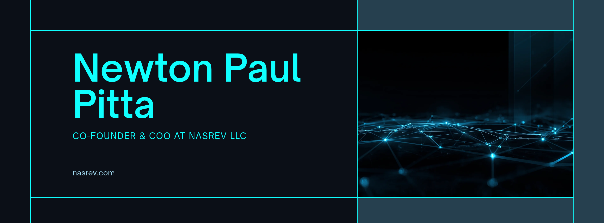

<p align="center">
  
</p>

<h1 align="center">Newton Paul Pitta</h1>

<p align="center">
  <a href="https://nasrev.com">
    
  </a>
</p>

<p align="center">
  <a href="https://nasrev.com"></a>
  <a href="https://in.linkedin.com/in/newtonpaulpitta"></a>
  <a href="https://www.crunchbase.com/person/newton-paul-pitta"></a>
  <a href="mailto:newton@nasrev.com"></a>
</p>

---

## Executive Overview

I am the **Co-Founder & Chief Operating Officer (COO)** at **[Nasrev LLC](https://nasrev.com)**, leading **Real-Time Bidding (RTB)** operations, programmatic supply/demand pipelines, and publisher monetization systems. With a **B.Sc. in Computers** and **2+ years of software engineering experience**, I bridge technical execution with programmatic AdTech operations to deliver transparent, high-yield monetization.

<table>
  <tr>
    <td width="50%" valign="top">
      <h3>🏢 Leadership &amp; Operations</h3>
      <ul>
        <li><strong>Role:</strong> Co-Founder &amp; COO at Nasrev LLC</li>
        <li><strong>Focus:</strong> Programmatic AdTech &amp; RTB Operations</li>
        <li><strong>Onboarding:</strong> Instant Google AdX access without MA/MI invites</li>
        <li><strong>Transparency:</strong> Live publisher earnings &amp; yield reporting</li>
      </ul>
    </td>
    <td width="50%" valign="top">
      <h3>⚡ Programmatic Infrastructure</h3>
      <ul>
        <li><strong>Protocols:</strong> OpenRTB specification &amp; auction routing</li>
        <li><strong>Platforms:</strong> Google Ad Manager 360 &amp; Google AdX</li>
        <li><strong>Ecosystem:</strong> SSP &amp; DSP supply/demand integrations</li>
        <li><strong>Optimization:</strong> High-CPM yield &amp; latency-sensitive bidding</li>
      </ul>
    </td>
  </tr>
</table>

---

## RTB & Programmatic Auction Architecture

```mermaid
flowchart LR
    A[Digital Publisher] -->|Ad Request| B[Nasrev Self-Serve Platform]
    B -->|GAM 360 / AdX| C[Supply-Side Platform - SSP]
    C -->|OpenRTB Bid Request| D[Real-Time Bidding Auction]
    D -->|Bid Requests| E[Demand-Side Platforms - DSPs]
    E -->|Highest CPM Bid| D
    D -->|Winning Creative| A
    B -->|Real-Time Analytics| F[Live Earnings Dashboard]
