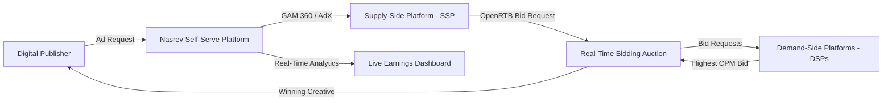

&lt;p align=&quot;center&quot;&gt;
  &lt;img src=&quot;banner.png&quot; alt=&quot;Newton Paul Pitta — Co-founder &amp; COO at Nasrev LLC&quot; width=&quot;100%&quot; /&gt;
&lt;/p&gt;

&lt;h1 align=&quot;center&quot;&gt;Newton Paul Pitta&lt;/h1&gt;

&lt;p align=&quot;center&quot;&gt;
  &lt;strong&gt;Co-Founder &amp;amp; Chief Operating Officer (COO) at &lt;a href=&quot;https://nasrev.com&quot;&gt;Nasrev LLC&lt;/a&gt;&lt;/strong&gt;&lt;br /&gt;
  &lt;em&gt;Real-Time Bidding (RTB) &amp;bull; OpenRTB Infrastructure &amp;bull; Google AdX &amp;amp; Ad Manager 360&lt;/em&gt;
&lt;/p&gt;

&lt;p align=&quot;center&quot;&gt;
  &lt;a href=&quot;https://nasrev.com&quot;&gt;&lt;img src=&quot;https://img.shields.io/badge/Nasrev_LLC-nasrev.com-0B0F17?style=for-the-badge&amp;logo=googlechrome&amp;logoColor=00E5FF&quot; alt=&quot;Nasrev LLC&quot; /&gt;&lt;/a&gt;
  &lt;a href=&quot;https://in.linkedin.com/in/newtonpaulpitta&quot;&gt;&lt;img src=&quot;https://img.shields.io/badge/LinkedIn-newtonpaulpitta-0B0F17?style=for-the-badge&amp;logo=linkedin&amp;logoColor=0A66C2&quot; alt=&quot;LinkedIn&quot; /&gt;&lt;/a&gt;
  &lt;a href=&quot;https://www.crunchbase.com/person/newton-paul-pitta&quot;&gt;&lt;img src=&quot;https://img.shields.io/badge/Crunchbase-Newton_Paul_Pitta-0B0F17?style=for-the-badge&amp;logo=crunchbase&amp;logoColor=146AFF&quot; alt=&quot;Crunchbase&quot; /&gt;&lt;/a&gt;
  &lt;a href=&quot;mailto:newton@nasrev.com&quot;&gt;&lt;img src=&quot;https://img.shields.io/badge/Email-newton%40nasrev.com-0B0F17?style=for-the-badge&amp;logo=gmail&amp;logoColor=EA4335&quot; alt=&quot;Email&quot; /&gt;&lt;/a&gt;
&lt;/p&gt;

---

## Executive Overview

I am the **Co-Founder & Chief Operating Officer (COO)** at **[Nasrev LLC](https://nasrev.com)**, leading **Real-Time Bidding (RTB)** operations, programmatic supply/demand pipelines, and publisher monetization systems. With a **B.Sc. in Computers** and **2+ years of software engineering experience**, I bridge technical execution with programmatic AdTech operations to deliver transparent, high-yield monetization.

&lt;table&gt;
  &lt;tr&gt;
    &lt;td width=&quot;50%&quot; valign=&quot;top&quot;&gt;
      &lt;h3&gt;🏢 Leadership &amp;amp; Operations&lt;/h3&gt;
      &lt;ul&gt;
        &lt;li&gt;&lt;strong&gt;Role:&lt;/strong&gt; Co-Founder &amp;amp; COO at Nasrev LLC&lt;/li&gt;
        &lt;li&gt;&lt;strong&gt;Focus:&lt;/strong&gt; Programmatic AdTech &amp;amp; RTB Operations&lt;/li&gt;
        &lt;li&gt;&lt;strong&gt;Onboarding:&lt;/strong&gt; Instant Google AdX access without MA/MI invites&lt;/li&gt;
        &lt;li&gt;&lt;strong&gt;Transparency:&lt;/strong&gt; Live publisher earnings &amp;amp; yield reporting&lt;/li&gt;
      &lt;/ul&gt;
    &lt;/td&gt;
    &lt;td width=&quot;50%&quot; valign=&quot;top&quot;&gt;
      &lt;h3&gt;⚡ Programmatic Infrastructure&lt;/h3&gt;
      &lt;ul&gt;
        &lt;li&gt;&lt;strong&gt;Protocols:&lt;/strong&gt; OpenRTB specification &amp;amp; auction routing&lt;/li&gt;
        &lt;li&gt;&lt;strong&gt;Platforms:&lt;/strong&gt; Google Ad Manager 360 &amp;amp; Google AdX&lt;/li&gt;
        &lt;li&gt;&lt;strong&gt;Ecosystem:&lt;/strong&gt; SSP &amp;amp; DSP supply/demand integrations&lt;/li&gt;
        &lt;li&gt;&lt;strong&gt;Optimization:&lt;/strong&gt; High-CPM yield &amp;amp; latency-sensitive bidding&lt;/li&gt;
      &lt;/ul&gt;
    &lt;/td&gt;
  &lt;/tr&gt;
&lt;/table&gt;

---

## RTB & Programmatic Auction Architecture

---

## Core Focus at Nasrev LLC

| Domain | Operational & Technical Capabilities |
| :--- | :--- |
| **RTB Auction Mechanics** | End-to-end Real-Time Bidding lifecycle, bid request/response optimization, and low-latency auction routing |
| **Protocol & Exchange Stack** | **OpenRTB** specification, **SSP** (Supply-Side Platform) & **DSP** (Demand-Side Platform) integrations |
| **Google AdTech Ecosystem** | **Google Ad Manager 360** & **Google AdX** self-serve platform operations with instant onboarding |
| **Yield & Revenue Analytics** | High-CPM yield optimization, live publisher earnings dashboards, and transparent revenue reporting |
| **Engineering & Automation** | API integrations, backend workflows, and programmatic tooling |

---

## Deep Dive: Key Initiatives

&lt;details&gt;
&lt;summary&gt;&lt;strong&gt;🚀 Google AdX &amp;amp; Ad Manager 360 Self-Serve Platform&lt;/strong&gt;&lt;/summary&gt;
&lt;br /&gt;
&lt;ul&gt;
  &lt;li&gt;&lt;strong&gt;Instant Access:&lt;/strong&gt; Streamlined publisher onboarding to Google AdX without traditional MA or MI invites.&lt;/li&gt;
  &lt;li&gt;&lt;strong&gt;High CPM Performance:&lt;/strong&gt; Yield-focused demand routing designed to maximize publisher revenue.&lt;/li&gt;
  &lt;li&gt;&lt;strong&gt;Live Earnings Dashboard:&lt;/strong&gt; Real-time visibility into impressions, CPMs, and revenue performance.&lt;/li&gt;
&lt;/ul&gt;
&lt;/details&gt;

&lt;details&gt;
&lt;summary&gt;&lt;strong&gt;🔄 OpenRTB &amp;amp; DSP/SSP Operations&lt;/strong&gt;&lt;/summary&gt;
&lt;br /&gt;
&lt;ul&gt;
  &lt;li&gt;&lt;strong&gt;Auction Pipeline Management:&lt;/strong&gt; Coordinating programmatic bid flows between supply-side and demand-side partners.&lt;/li&gt;
  &lt;li&gt;&lt;strong&gt;OpenRTB Standards:&lt;/strong&gt; Ensuring clean bid request formatting, partner compliance, and auction efficiency.&lt;/li&gt;
&lt;/ul&gt;
&lt;/details&gt;

---

## Technical Stack

&lt;p align=&quot;center&quot;&gt;
  &lt;img src=&quot;https://img.shields.io/badge/Python-0B0F17?style=for-the-badge&amp;logo=python&amp;logoColor=3776AB&quot; alt=&quot;Python&quot; /&gt;
  &lt;img src=&quot;https://img.shields.io/badge/Java-0B0F17?style=for-the-badge&amp;logo=openjdk&amp;logoColor=ED8B00&quot; alt=&quot;Java&quot; /&gt;
  &lt;img src=&quot;https://img.shields.io/badge/JavaScript-0B0F17?style=for-the-badge&amp;logo=javascript&amp;logoColor=F7DF1E&quot; alt=&quot;JavaScript&quot; /&gt;
  &lt;img src=&quot;https://img.shields.io/badge/HTML5-0B0F17?style=for-the-badge&amp;logo=html5&amp;logoColor=E34F26&quot; alt=&quot;HTML5&quot; /&gt;
  &lt;img src=&quot;https://img.shields.io/badge/CSS3-0B0F17?style=for-the-badge&amp;logo=css3&amp;logoColor=1572B6&quot; alt=&quot;CSS3&quot; /&gt;
  &lt;img src=&quot;https://img.shields.io/badge/Firebase-0B0F17?style=for-the-badge&amp;logo=firebase&amp;logoColor=FFCA28&quot; alt=&quot;Firebase&quot; /&gt;
&lt;/p&gt;

---

&lt;p align=&quot;center&quot;&gt;
  &lt;strong&gt;Connect with me on programmatic advertising, RTB infrastructure &amp;amp; publisher monetization&lt;/strong&gt;&lt;br /&gt;&lt;br /&gt;
  &lt;a href=&quot;https://nasrev.com&quot;&gt;nasrev.com&lt;/a&gt; &amp;bull;
  &lt;a href=&quot;https://github.com/NewtonPaulPitta&quot;&gt;GitHub&lt;/a&gt; &amp;bull;
  &lt;a href=&quot;https://in.linkedin.com/in/newtonpaulpitta&quot;&gt;LinkedIn&lt;/a&gt; &amp;bull;
  &lt;a href=&quot;https://www.crunchbase.com/person/newton-paul-pitta&quot;&gt;Crunchbase&lt;/a&gt; &amp;bull;
  &lt;a href=&quot;mailto:newton@nasrev.com&quot;&gt;newton@nasrev.com&lt;/a&gt;
&lt;/p&gt;